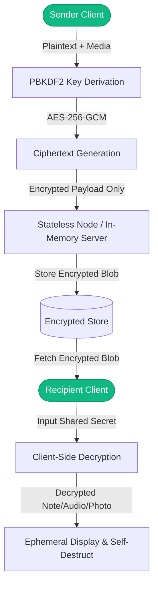

# Shadow Message Cipher — Ephemeral Encrypted Messaging & Steganography Vault

> Zero-knowledge in-memory secure communication portal with client-side AES-GCM / WebCrypto encryption, camera capture, voice recording, and timed message expiration.

---

## 1. Project Title
**Shadow Message Cipher** (`SDC-Level-3`) — High-Security Ephemeral Encrypted Messaging Platform.

## 2. Project Overview
Shadow Message Cipher is an advanced secure communication system developed to ensure private, end-to-end protected communication. It allows users to encrypt confidential notes, voice recordings, and camera snapshots using browser-native cryptography before transmission. Messages are designed to be ephemeral and decay securely after access.

## 3. Problem Statement
Traditional communication channels leak metadata and store unencrypted payloads on server-side databases indefinitely. Shadow Message Cipher eliminates central plaintext storage by encrypting payloads client-side with user-held passphrase keys, rendering server databases zero-knowledge vaults.

## 4. Objectives
- **Implemented:**
  - Client-side WebCrypto AES-GCM encryption with dynamic IV and salt generation.
  - Multimedia message support (in-browser voice recording and camera modal capture).
  - Passphrase-protected recipient decryption panels.
  - Comprehensive laboratory report (`SDC Level-3 Report.pdf`) detailing threat modeling.
- **Future Goals:**
  - Post-quantum lattice-based encryption algorithms (Kyber / Dilithium).
  - PDF & image steganography carrier embedding.

## 5. Key Features
- **Client-Side Cryptography:** No plaintext ever leaves the browser.
- **Voice Message Encryption:** Record audio blobs in-browser, encrypting the raw binary.
- **Camera Snapshot Encryption:** Capture and cipher photos directly from camera streams.
- **Decay & Ephemerality:** Timed message expiry and burn-after-reading semantics.
- **Clean Responsive Interface:** Built with React 18, Tailwind CSS, and shadcn/ui components.

## 6. Screenshots and Visual Demonstration
```
+--------------------------------------------------------------+
|                   SHADOW MESSAGE CIPHER                      |
| [🔒 Encrypt Message]       [🔑 Decrypt In-Memory Payload]    |
|                                                              |
| Enter Secret Note: [                                      ]  |
| Options: [🎙️ Record Voice]  [📸 Capture Photo]  [Burn: 5m] |
| Encryption Key: [••••••••••••••••]                           |
| [ ENCRYPT & GENERATE SECURE CIPHERTEXT ]                     |
+--------------------------------------------------------------+
```

## 7. Technology Stack
- **Frontend:** React 18, Vite, TypeScript, Tailwind CSS, shadcn/ui, Lucide Icons
- **Cryptography:** Web Crypto API (SubtleCrypto), PBKDF2, AES-256-GCM
- **Media APIs:** MediaDevices API (getUserMedia, MediaRecorder)
- **Backend / Store:** Node.js Express server (`server/index.js`) with atomic file storage (`data.json`)

## 8. System Architecture


## 9. Folder Structure
```
SDC-Level-3/
├── server/
│   ├── data.json             # Ephemeral message storage
│   └── index.js              # Lightweight Express relay server
├── src/
│   ├── components/
│   │   ├── auth/             # Login and register interfaces
│   │   ├── layout/           # App header, layout shell
│   │   ├── message/          # Message cards, camera modal, audio recorder
│   │   └── ui/               # Modular shadcn component library
│   ├── context/              # Auth and Message application state
│   ├── utils/
│   │   └── encryption.ts     # WebCrypto AES-GCM & PBKDF2 implementation
│   ├── pages/                # Dashboard, Inbox, Landing, and Auth views
│   ├── App.tsx               # Root route declarations
│   └── main.tsx              # DOM mounting point
├── SDC Level-3 Report.pdf    # Full engineering project & security report
├── package.json              # Project dependencies and build scripts
└── README.md                 # Enterprise technical documentation
```

## 10. Installation Requirements
- **Node.js:** v18.0.0 or higher
- **npm:** v9.0.0 or higher

## 11. Installation Instructions
```bash
# Clone the repository
git clone https://github.com/StratagemVX/SDC-Level-3.git
cd SDC-Level-3

# Install dependencies
npm install

# Start local server and frontend
npm run dev
```

## 12. Environment Variables (`.env.example`)
```env
VITE_API_URL=http://localhost:3000
VITE_ENCRYPTION_SALT_ROUNDS=100000
```

## 13. Security Considerations
- **Zero Knowledge Architecture:** Encryption and decryption take place strictly in browser memory.
- **Authenticated Encryption:** AES-GCM provides both confidentiality and data integrity verification.
- **Key Derivation:** Keys are derived using PBKDF2 with SHA-256 and at least 100,000 iterations.

## 14. Testing
```bash
npm run build
npm run lint
```

## 15. Author & Project Information
- **Author:** Chethan Kumar B S (`StratagemVX`)
- **Institution:** MVJ College of Engineering
- **Focus:** Cybersecurity, Zero-Trust Cryptography & Secure Systems
