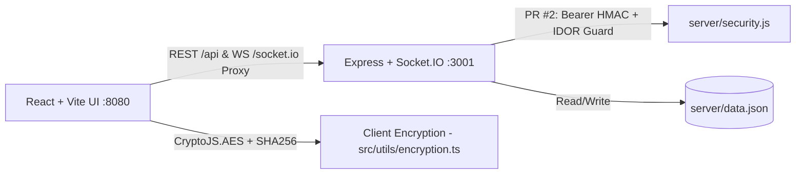

# Shadow Message Cipher (`SDC-Level-3`) — Encrypted Messaging & Media Vault

> Real-time encrypted text and media messaging application built with React 18, TypeScript, Express, Socket.IO, and client-side `CryptoJS` symmetric cryptography.

[](https://www.typescriptlang.org/)
[](https://react.dev/)
[](https://expressjs.com/)
[](https://socket.io/)

---

## Executive Overview

**Shadow Message Cipher** (`SDC-Level-3`) is a full-stack academic security application for sending self-destructing text messages and file/audio/camera attachments between registered users. The React client encrypts message payloads locally using `CryptoJS` (`src/utils/encryption.ts`) before transmitting payloads to the Node.js/Express + Socket.IO server (`server/index.js`), which stores records in `server/data.json` and pushes real-time notifications and typing indicators over WebSockets.

> **Security & Remediation Status (`main` vs. Draft PR #2):**
> - On `main`: `server/index.js` allows wildcard CORS (`origin: "*"`) without token verification on message routes/sockets, and `.env.example` contains unused frontend placeholders.
> - On open Draft PR #2 (`maintenance/repository-quality-improvements`): adds `server/security.js` implementing **HMAC-SHA256 Bearer authentication** for HTTP routes and Socket.IO connections, explicit `CORS_ALLOWED_ORIGINS` validation (rejecting `*`), prototype-key-safe `readOwnUser`/`isValidUserId`, per-IP authentication rate limiting, sender/recipient **IDOR access checks** on message retrieval & deletion, response security headers (`X-Content-Type-Options`, `X-Frame-Options`, `Referrer-Policy`, `Permissions-Policy`), safe file download sanitization (`sanitizeFileName`), `.env.example` server configuration (`PORT`, `HOST`, `SESSION_SECRET`, `CORS_ALLOWED_ORIGINS`), Vitest unit/security tests (`server/security.test.js`, `src/utils/encryption.test.ts`), and `.github/workflows/quality.yml`.

---

## Implemented Features & Cryptography

### Application Features
- **Client-Side Message & File Encryption (`src/utils/encryption.ts`):** Synchronous helpers powered by `crypto-js`:
  - `encryptMessage(message, secretKey)` / `decryptMessage(encryptedMessage, secretKey)` (`CryptoJS.AES`)
  - `hashSecretKey(secretKey)` (`CryptoJS.SHA256`)
  - `encryptFilePayload(file, secretKey)` / `decryptFilePayload(encryptedMessage, secretKey)`
  - `sanitizeFileName`, `detectFileCategory`, `formatFileSize`, `fileToBase64`, `base64ToBlob`
- **Voice Note & Camera Capture (`src/components/message/`):** In-browser webcam snapshot modal (`CameraModal.tsx`) and voice recording UI (`VoiceRecorderUI.tsx`) for encrypting binary attachments client-side.
- **Express REST + Socket.IO Server (`server/index.js`):**
  - HTTP routes: `POST /api/register`, `POST /api/login`, `GET /api/users`, `GET /api/messages/:userId`, `POST /api/messages`, `DELETE /api/messages/:messageId`
  - WebSocket events: `send_message`, `typing`, `stop_typing`, `disconnect`
- **Academic Documentation:** Includes `SDC Level-3 Report.docx` and `SDC Level-3 Report.pdf` in the repository root.

### Technical Architecture


---

## Known Limitations & Hardening Notes

- **Cryptographic Primitive:** `src/utils/encryption.ts` uses passphrase-based `CryptoJS.AES` (OpenSSL EVP key derivation) rather than Web Crypto `AES-256-GCM`; migrating to `crypto.subtle` AEAD with explicit salts/IVs is a recommended future enhancement.
- **Storage Backend:** `server/data.json` is intended for local/academic demonstration; deploy with a proper database and TLS termination behind `SESSION_SECRET` and explicit `CORS_ALLOWED_ORIGINS` before real-world use.
- **Dev SSL:** `vite.config.ts` enables `@vitejs/plugin-basic-ssl` on port `8080` so camera/microphone APIs work on localhost over HTTPS, proxying `/api` and `/socket.io` to `http://localhost:3001`.

---

## Directory Structure

```text
SDC-Level-3/
├── .github/workflows/quality.yml   # npm ci, audit, node --check, typecheck, lint, test, build (PR #2)
├── server/
│   ├── data.json                   # Local JSON persistence store
│   ├── index.js                    # Express + Socket.IO server
│   ├── security.js                 # Auth, CORS allowlist, rate limit, secret & key guards (PR #2)
│   └── security.test.js            # Server security unit tests (PR #2)
├── src/
│   ├── components/
│   │   ├── auth/                   # LoginForm, RegisterForm
│   │   ├── layout/                 # Header, Layout
│   │   ├── message/                # CameraModal, VoiceRecorderUI, MessageCard, MessageList, InlineError
│   │   └── ui/                     # shadcn/ui components
│   ├── context/                    # AuthContext, MessageContext
│   ├── pages/                      # LandingPage, DashboardPage, InboxPage
│   ├── utils/
│   │   ├── encryption.ts           # CryptoJS AES/SHA256 & attachment helpers
│   │   └── encryption.test.ts      # Frontend encryption unit tests (PR #2)
│   └── App.tsx
├── .env.example                    # Placeholder env vars (updated in PR #2)
├── SDC Level-3 Report.pdf          # Academic security report
├── package.json
└── README.md
```

---

## Setup, Environment & Verification

### Server Environment Configuration (PR #2 `.env.example`)
Copy `.env.example` to `.env` before running with server hardening:

| Variable | Description | Default / Constraint |
|---|---|---|
| `PORT` | Backend Express port | `3001` |
| `HOST` | Backend bind address | `127.0.0.1` |
| `SESSION_SECRET` | HMAC token signing key | Required >= 32 chars in `production`; ephemeral in dev |
| `CORS_ALLOWED_ORIGINS` | Comma-separated exact HTTP/HTTPS origins | Wildcard `*` rejected |

### Commands & Verification Scripts (`package.json`)
```bash
git clone https://github.com/StratagemVX/SDC-Level-3.git
cd SDC-Level-3
npm ci --ignore-scripts
npm run dev
```

| Script | Command | Purpose |
|---|---|---|
| `npm run dev` | `concurrently "vite --host" "node server/index.js"` | Start HTTPS Vite dev server (:8080) & API (:3001) |
| `npm run build` | `vite build` | Build production frontend bundle |
| `npm run start` | `node server/index.js` | Run Express + Socket.IO server |
| `npm run serve` | `npm run build && npm run start` | Build frontend then serve API |
| `npm run typecheck` | `tsc --noEmit` | TypeScript check (added in PR #2) |
| `npm run lint` | `eslint .` | ESLint static analysis |
| `npm test` | `vitest run` | Run `server/security.test.js` & `src/utils/encryption.test.ts` (PR #2) |

---

## Contributor Attribution & Profile

- **Lead Engineer:** Chethan Kumar B S (`StratagemVX`)
- **Archived Predecessor:** `StratagemVX/ShadowComm` (read-only archive pointing to `SDC-Level-3`)
- **GitHub:** [https://github.com/StratagemVX](https://github.com/StratagemVX)
- **Portfolio:** [https://chethan-kumar-portfolio.vercel.app/](https://chethan-kumar-portfolio.vercel.app/)
- **LinkedIn:** [https://linkedin.com/in/chethan-kumar-b-s-781a002bb](https://linkedin.com/in/chethan-kumar-b-s-781a002bb)
