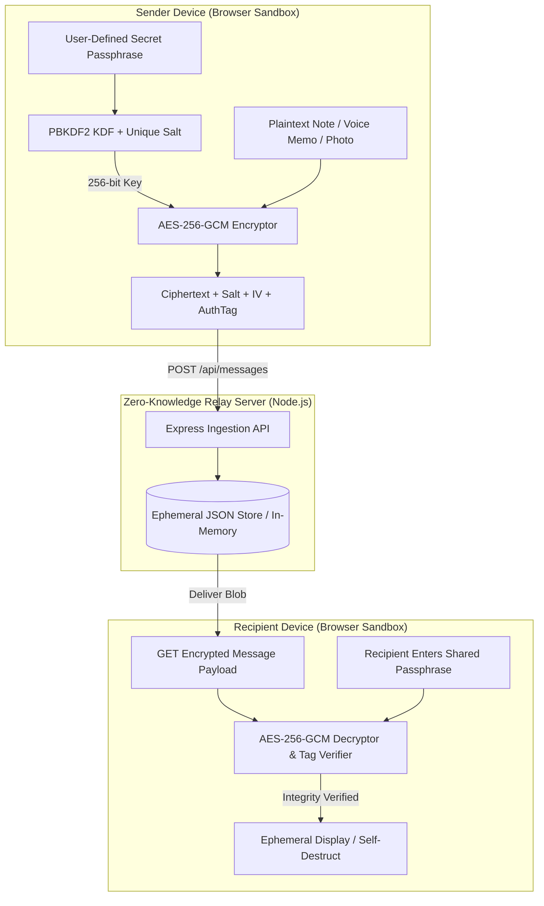
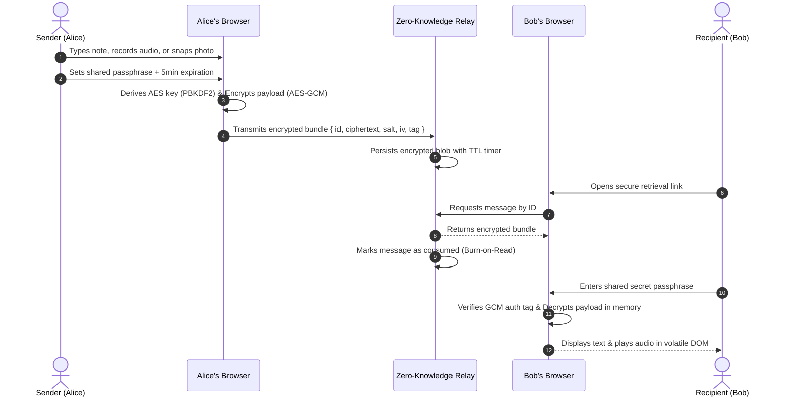

# Shadow Message Cipher — Ephemeral Encrypted Messaging & Steganography Vault

> A zero-knowledge in-memory secure communication platform engineered with client-side WebCrypto AES-256-GCM encryption, dynamic IV derivation, in-browser audio recording, and camera capture.

[](https://www.typescriptlang.org/)
[](https://react.dev/)
[](https://tailwindcss.com/)
[](https://developer.mozilla.org/en-US/docs/Web/API/Web_Crypto_API)

---

## Executive Overview

Shadow Message Cipher (`SDC-Level-3`) is an advanced private messaging application engineered to protect confidential communications against eavesdropping, unauthorized interception, and persistent server-side forensics. Utilizing browser-native cryptography (W3C Web Crypto API), the platform encrypts text, camera snapshots, and voice memos entirely on the client before transmitting the ciphertext to a stateless relay. The server retains zero decryption capability, and messages are configured with burn-after-reading decay mechanics.

---

## Threat Model & Security Posture

### Adversary Capabilities Addressed
1. **Compromised Storage / Database Snooping:** An adversary who gains complete access to server storage encounters only salted, authenticated AES-256-GCM ciphertext blobs.
2. **Man-in-the-Middle (MitM) Payload Tampering:** AES-GCM generates a 128-bit authentication tag; any ciphertext alteration in transit causes immediate decryption failure.
3. **Forensic Device Seizure:** Messages self-destruct upon decryption or after user-configured expiration timers, preventing post-facto recovery from persistent media.

### Cryptographic Implementation Specifications
- **Cipher Algorithm:** AES-GCM (Galois/Counter Mode) with 256-bit key length.
- **Key Derivation Function (KDF):** PBKDF2 (Password-Based Key Derivation Function 2) utilizing SHA-256 and 100,000 computational iterations.
- **Initialization Vector (IV):** Cryptographically secure pseudo-random 96-bit IV generated per message via `crypto.getRandomValues()`.
- **Salt:** 128-bit unique salt per message prevents pre-computed rainbow table attacks.

---

## Core Capabilities & Features

### Implemented Features
- **Client-Side Symmetric Encryption:** Confidential text notes are transformed into armored ciphertext locally inside `src/utils/encryption.ts`.
- **In-Browser Audio Recording:** Captures raw voice notes via the MediaRecorder API, converting audio streams to binary blobs and encrypting them client-side.
- **Integrated Camera Snapshot Capture:** Secure webcam interface captures modal photos directly into encrypted data streams without saving raw photos to disk.
- **Burn-on-Read Ephemerality:** Configurable expiration countdowns trigger automated deletion from the server once a message has been opened.
- **Zero-Knowledge Architecture:** No passphrases, keys, or plaintext data ever touch network sockets or server storage.
- **Comprehensive Project Security Report:** Includes complete academic project documentation (`SDC Level-3 Report.pdf`).

---

## Technical Architecture



---

## Application Workflow



---

## Directory Structure

```text
SDC-Level-3/
├── server/
│   ├── data.json             # Ephemeral encrypted message store
│   └── index.js              # Lightweight Express relay server
├── src/
│   ├── components/
│   │   ├── auth/             # LoginForm, RegisterForm components
│   │   ├── layout/           # Header, App Layout shell
│   │   ├── message/          # MessageCard, CameraModal, VoiceRecorderUI
│   │   └── ui/               # Modular shadcn UI component library
│   ├── context/              # AuthContext & MessageContext state management
│   ├── utils/
│   │   └── encryption.ts     # WebCrypto AES-GCM & PBKDF2 implementation
│   ├── pages/                # DashboardPage, InboxPage, LandingPage
│   ├── App.tsx               # Application routing and providers
│   └── main.tsx              # DOM mounting point
├── SDC Level-3 Report.docx   # Academic project engineering specification
├── SDC Level-3 Report.pdf    # Full security evaluation and architecture report
├── package.json              # Dependencies and build configuration
├── tailwind.config.ts        # Tailwind theme definitions
└── README.md                 # Master repository technical documentation
```

---

## Setup & Installation

### Prerequisites
- Node.js v18.0.0 or higher
- npm v9.0.0 or higher

### Local Development Setup
```bash
# Clone the repository
git clone https://github.com/StratagemVX/SDC-Level-3.git
cd SDC-Level-3

# Install dependencies
npm install

# Start development frontend and mock server
npm run dev
```
Open your browser at `http://localhost:5173`.

---

## Environment Configuration

Create `.env` using `.env.example`:

| Variable | Description | Scope | Mandatory |
|---|---|---|:---:|
| `VITE_API_URL` | Relay server URL (default: `http://localhost:3000`) | Client-side | Yes |
| `VITE_ENCRYPTION_SALT_ROUNDS` | PBKDF2 iteration rounds (default: `100000`) | Client-side | Yes |

---

## Cryptographic Utilities Reference (`src/utils/encryption.ts`)

The core encryption methods expose a pure Promise-based asynchronous interface:
- `deriveKey(passphrase: string, salt: Uint8Array): Promise<CryptoKey>`
- `encryptPayload(data: string | ArrayBuffer, key: CryptoKey): Promise<{ ciphertext: string, iv: string, tag: string }>`
- `decryptPayload(bundle: EncryptedBundle, key: CryptoKey): Promise<string | ArrayBuffer>`

---

## Verification & Testing

```bash
# Verify TypeScript compile-time type safety
npm run build

# Run linting inspections
npm run lint
```

---

## Contributor Attribution & Profile

- **Lead Engineer:** Chethan Kumar B S (`StratagemVX`)
- **Institution:** Department of Computer Science & Engineering, MVJ College of Engineering
- **GitHub:** [https://github.com/StratagemVX](https://github.com/StratagemVX)
- **Portfolio:** [https://chethan-kumar-portfolio.vercel.app/](https://chethan-kumar-portfolio.vercel.app/)
- **LinkedIn:** [https://linkedin.com/in/chethan-kumar-b-s-781a002bb](https://linkedin.com/in/chethan-kumar-b-s-781a002bb)

## Verification and maintenance

Keep the project's problem statement, architecture, data sources, and feature claims aligned with the implementation. Clearly distinguish implemented behavior from planned or experimental capabilities.

### Available package scripts

- `npm run dev` — `concurrently "vite --host" "node server/index.js"`
- `npm run build` — `vite build`
- `npm run lint` — `eslint .`
- `npm run preview` — `vite preview`
- `npm run start` — `node server/index.js`

These commands are declared by the package manifest; this documentation update does not imply they have passed.

### Contribution and security notes

- Document datasets, model assumptions, and external services where relevant; do not imply unverified accuracy or performance.
- Never commit credentials, private keys, personal data, or local environment files.
- Use placeholder-only configuration examples and deployment-managed secrets.
- Include reproducible issue steps and expected/actual results.
- Run relevant build, lint, and test checks before merging.
